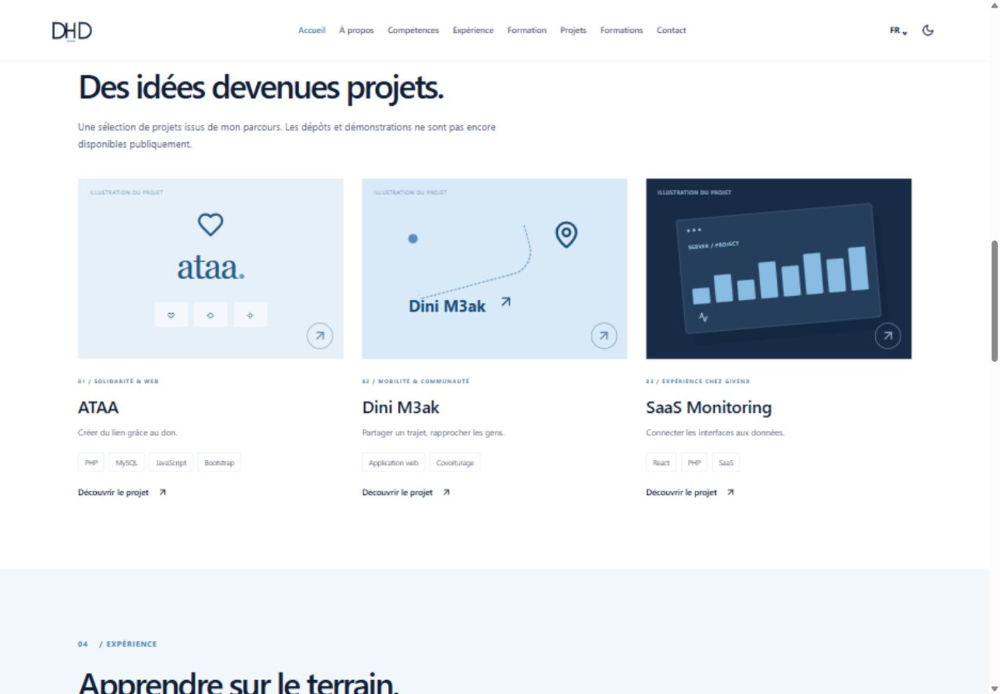

# DHD — Doha Hanine Daoudi

Portfolio professionnel bilingue français / anglais, conçu en React, TypeScript et Vite. Fond blanc, bleu marine et bleu ciel, portrait personnel et CV téléchargeables.



## Français

### Démarrage

Node.js 22 ou version compatible.

```sh
npm ci
npm run dev
```

### Vérifications et production

```sh
npm run typecheck
npm run lint
npm run build
npm run preview
```

Fonctionnalités : langues FR/EN, thème clair/sombre persistant, menu mobile, navigation par ancres, animations respectant la réduction des mouvements, fiches projets accessibles au clavier, chronologie dépliable, deux CV PDF avec photo, liens e-mail, métadonnées SEO, sitemap et favicon DHD original.

Le workflow `.github/workflows/deploy.yml` construit et déploie sur GitHub Pages à chaque push sur `main`. Dans Settings → Pages, la source doit être GitHub Actions. La base Vite est `/dhd-portfolio/`.

Les contenus proviennent des CV fournis. Les visuels des projets sont des illustrations, pas des captures d’applications. Les dépôts des projets et leurs démonstrations ne sont pas publiés ; aucun lien fictif n’est affiché. Le CV anglais est une traduction à relire. Aucun profil LinkedIn n’a été fourni.

Contenu : `src/content.ts` ; interface : `src/main.tsx` ; styles : `src/style.css` ; documents : `public/cv/`.

## English

A bilingual professional portfolio built with React, TypeScript, Vite, Tailwind CSS, Motion and Lucide. Run `npm ci` and `npm run dev` for development; `npm run build` creates the static site in `dist/`.

Includes persistent French/English and light/dark preferences, responsive navigation, keyboard-accessible project dialogs, reduced-motion support, experience timelines, downloadable photo CVs, email links and SEO metadata.

GitHub Actions publishes changes from `main` to GitHub Pages. Select GitHub Actions as the Pages source. Project illustrations are conceptual, not product screenshots. Project repositories and demos are not publicly available. The English résumé is marked as a draft for review. No LinkedIn URL was supplied.

Personal photos and CVs belong to Doha Hanine Daoudi. No blanket license is granted for reuse of personal assets.
